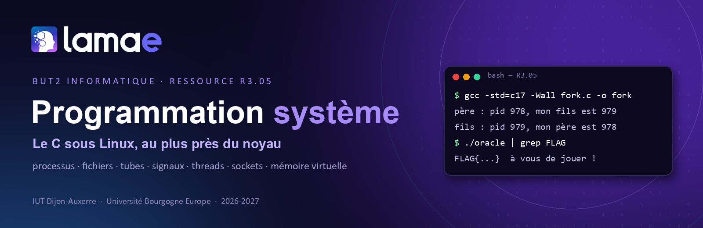
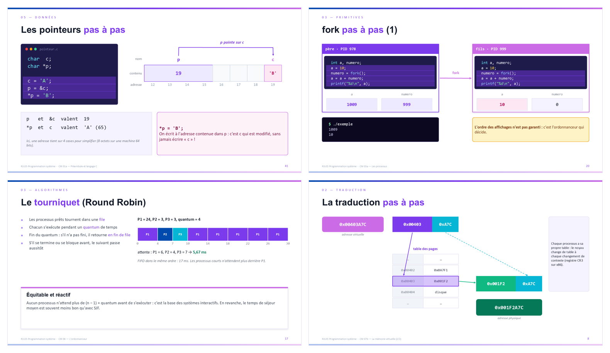

<p align="center">
  
</p>

<p align="center">
  
  
  
  
  
  <a href="https://www.buymeacoffee.com/christophecruz"></a>
</p>

<p align="center">
  <b>Comprendre ce qui se passe sous le capot :</b> comment un programme naît, crée d'autres processus,<br>
  lit et écrit des fichiers, communique, se synchronise… et comment le noyau gère tout cela.
</p>

---

## 🚀 Pourquoi ce module ?

Votre navigateur, votre serveur web, votre base de données, Docker, le shell : tous reposent sur les mêmes briques, celles du **système d'exploitation**. Dans ce module, vous les manipulez directement, en C, sous Linux.

- 🧠 **Comprendre** : mémoire, processus, ordonnancement, mémoire virtuelle, expliqués avec des animations pas à pas.
- 🛠️ **Pratiquer** : 9 TP de 2 h, avec du code de départ prêt à compiler.
- 🎮 **Jouer** : chaque TP a son fil rouge (*Badge LAMAE*, *La Ruche*, *Radio clandestine*, *Oracle*…) et des drapeaux `FLAG{...}` à découvrir.
- 🔐 **Sécuriser** : débordements de tampon, fuites, conditions de course, entrées réseau hostiles. Chaque séance a son volet sécurité, dans l'esprit du guide de l'ANSSI.

<p align="center">
  
  <br><sub>Quelques diapositives : les pointeurs, <code>fork</code>, le tourniquet, la traduction d'adresse.</sub>
</p>

## 📚 Les cours magistraux

> Chaque cours existe en **PDF** (pour lire et annoter) et en **PowerPoint** (pour voir les animations).

| | Cours | Au programme |
|:-:|---|---|
| 01a | [Préambule et langage C](cours/CM01a-preambule-et-langage-C.pdf) | rôle de l'OS, compilation, types, tableaux, pointeurs |
| 01b | [Entrées-sorties et allocation dynamique](cours/CM01b-entrees-sorties-et-allocation-dynamique.pdf) | stdin/stdout/stderr, `fgets`, `malloc`, `free` |
| 02 | [Les fichiers](cours/CM02-les-fichiers.pdf) | `open`, `read`, `write`, `lseek`, i-nœuds |
| 03a | [Les processus](cours/CM03a-les-processus.pdf) | `fork`, `exec`, `wait`, zombies |
| 03b | [Tubes et concurrence](cours/CM03b-tubes-et-concurrence.pdf) | `pipe`, `dup2`, `mkfifo`, sections critiques |
| 04 | [Signaux et IPC](cours/CM04-signaux-et-IPC.pdf) | `kill`, `sigaction`, files de messages, mémoire partagée |
| 05 | [Sémaphores, moniteurs, philosophes](cours/CM05-semaphores-moniteurs-philosophes.pdf) | producteur-consommateur, interblocage |
| 06 | [L'ordonnanceur](cours/CM06-ordonnanceur.pdf) | FIFO, SJF, tourniquet, priorités, CFS |
| 07a | [Mémoire virtuelle (1/2)](cours/CM07a-memoire-virtuelle-1.pdf) | MMU, segmentation, pile et tas |
| 07b | [Mémoire virtuelle (2/2)](cours/CM07b-memoire-virtuelle-2.pdf) | pagination, TLB, défauts de page, swap |

## 🧪 Les TD/TP

| | Sujet | Mission | Code de départ |
|:-:|---|---|---|
| 01 | [Le langage C, partie 1](sujets/Sujet01-langage-C-partie-1.pdf) | Badge LAMAE | [`code/sujet01`](code/sujet01) |
| 02 | [Le langage C, partie 2](sujets/Sujet02-langage-C-partie-2.pdf) | Inventaire de Mos Eisley | [`code/sujet02`](code/sujet02) |
| 03 | [Les pointeurs](sujets/Sujet03-pointeurs.pdf) | Mémoire vive | [`code/sujet03`](code/sujet03) |
| 04 | [L'allocation dynamique](sujets/Sujet04-allocation-dynamique.pdf) | Le manoir du tas | [`code/sujet04`](code/sujet04) |
| 05 | [Les fichiers](sujets/Sujet05-fichiers.pdf) | Coffre-fort | [`code/sujet05`](code/sujet05) |
| 06 | [Les processus](sujets/Sujet06-processus.pdf) | La Ruche | [`code/sujet06`](code/sujet06) |
| 07 | [Les tubes](sujets/Sujet07-tubes.pdf) | Radio clandestine | [`code/sujet07`](code/sujet07) |
| 08 | [Les threads et les mutex](sujets/Sujet08-threads-et-mutex.pdf) | Essaim de drones | [`code/sujet08`](code/sujet08) |
| 09 | [Les sockets](sujets/Sujet09-sockets.pdf) | Oracle | [`code/sujet09`](code/sujet09) |

Les exercices sont notés de ★ (incontournable) à ★★★ (pour aller plus loin). Chaque sujet se termine par une section **« Aller plus loin »** : pages du manuel, livres, outils.

## ⚡ Démarrer en 30 secondes

```bash
sudo apt update && sudo apt install gcc build-essential gdb valgrind   # une seule fois
git clone https://github.com/ChristopheCruz/but2-r305-prog-sys.git
cd but2-r305-prog-sys/code/sujet01
gcc -std=c17 -Wall -Wextra -pedantic -g hello.c -o hello
./hello
```

**La ligne de compilation du module :**

```bash
gcc -std=c17 -Wall -Wextra -pedantic -g programme.c -o programme
```

| Besoin | Ajoutez |
|---|---|
| fonctions POSIX (`fork`, `pipe`, `sigaction`…) | `#define _POSIX_C_SOURCE 200809L` en **première ligne** du fichier |
| threads | `-pthread` |
| traquer les erreurs mémoire | `-fsanitize=address,undefined`, ou `valgrind --leak-check=full ./programme` |
| traquer les conditions de course | `-fsanitize=thread` |

> [!WARNING]
> Certains fichiers de départ contiennent des erreurs **volontaires** : ce sont des supports d'exercice. Par exemple, `code/sujet09/serveur_naif.c` est vulnérable exprès, pour l'exercice d'audit. Ne les réutilisez pas tels quels.

## 🗂️ Organisation du dépôt

```
but2-r305-prog-sys/
├── cours/     les 10 cours magistraux (PDF + PowerPoint)
├── sujets/    les 9 sujets de TD/TP (PDF + Word)
├── code/      le code de départ, un dossier par sujet
└── assets/    les images de ce README
```

## 📖 Pour aller plus loin

- **Le manuel**, votre meilleur ami : `man 2 open`, `man 2 fork`, `man 7 signal`, `man 7 pipe`…
- [cppreference](https://en.cppreference.com/w/c) : la bibliothèque standard du C
- [Guide de l'ANSSI](https://cyber.gouv.fr/publications/regles-de-programmation-pour-le-developpement-securise-de-logiciels-en-langage-c) : règles de programmation sécurisée en C
- [*Operating Systems: Three Easy Pieces*](https://pages.cs.wisc.edu/~remzi/OSTEP/) : un excellent livre, gratuit en ligne
- M. Kerrisk, *The Linux Programming Interface* (No Starch Press) : la référence de la programmation système Linux
- A. Tanenbaum, *Systèmes d'exploitation* (Pearson)

## ☕ Un café pour l'auteur ?

Ces supports sont libres et gratuits. S'ils vous ont aidé à comprendre `fork`, à dompter les pointeurs ou à décrocher un `FLAG{...}`, vous pouvez offrir un café pour encourager leur mise à jour :

<p align="center">
  <a href="https://www.buymeacoffee.com/christophecruz">
    
  </a>
</p>

## 📜 Licences

- **Diapositives et sujets** (`cours/`, `sujets/`) : [CC BY-NC-SA 4.0](https://creativecommons.org/licenses/by-nc-sa/4.0/deed.fr), voir [`LICENSE-supports.md`](LICENSE-supports.md).
- **Code** (`code/`) : licence MIT, voir [`LICENSE`](LICENSE).

---

<p align="center">
  <sub>R3.05 Programmation système · BUT2 Informatique · IUT Dijon-Auxerre · Université Bourgogne Europe<br>
  Christophe Cruz · 2026-2027 · design LAMAE</sub>
</p>
